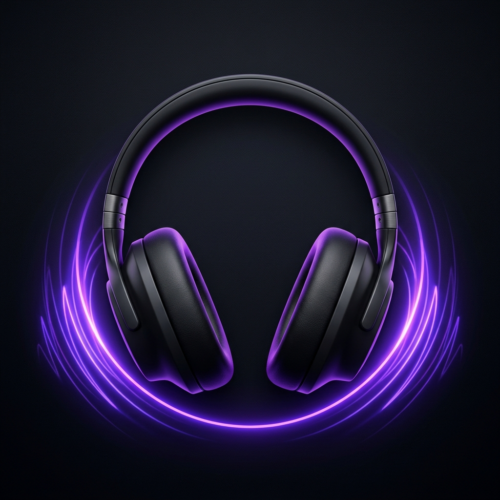

<div align="center">



# 🎧 Spigen Audio CTRL — Windows

**The Ultimate Native Hardware Companion for Spigen SA-HP P10 Over-Ear Headphones**

[](https://github.com/0-Name-Alex/Spigen-Audio-CTRL-Windows/releases)
[](https://github.com/0-Name-Alex/Spigen-Audio-CTRL-Windows)
[](https://github.com/0-Name-Alex/Spigen-Audio-CTRL-Windows)
[](LICENSE)

<br/>

[📥 **Download Latest Standalone EXE (v1.0.1)**](https://github.com/0-Name-Alex/Spigen-Audio-CTRL-Windows/releases) • [✨ Features](#-key-features) • [🚀 Quick Start](#-quick-start) • [🎛️ Task Hub Architecture](#-task-hub-architecture) • [🔧 Troubleshooting](#-troubleshooting)

<br/>

---

</div>

## 🌟 Overview

**Spigen Audio CTRL (Windows)** is an ultra-fast, native desktop companion application engineered specifically for the **Spigen SA-HP P10** hybrid ANC wireless headphones.

Unlike generic equalizer software that applies laggy software audio filters on your PC, **Spigen Audio CTRL communicates directly with the headphone's on-chip Jie-Li (JL) DSP microcontroller over Bluetooth Low Energy (BLE)**. Every setting—from parametric EQ curves and noise cancellation profiles to hardware button mappings—is flashed directly into the headphone's on-board memory.

---

## ✨ Key Features

### 🎧 1. Active Noise Control (ANC) Engine
* **6 Dedicated Hardware Acoustic Profiles:**
  * **Deep ANC (-43 dB):** Maximum dual-mic acoustic isolation for flights, transit, and loud environments.
  * **Adaptive ANC:** Continuously recalibrates filter coefficients to ambient decibels and current ear-seal.
  * **Commuting:** Targets repetitive low-frequency vehicle engine rumble.
  * **Anti-Wind:** Suppresses outdoor air turbulence across forward-facing feedforward microphones.
  * **Transparency:** Streams crystal-clear natural ambient voices and environmental audio.
  * **Passive Off:** Bypasses active DSP filtering for extended battery preservation.
* **Master Quick-Bar:** 1-Click instant toggle between *Active ANC*, *Transparency*, and *Off*.

### 🎚️ 2. 10-Band Studio DSP Equalizer
* **Direct Hardware Filtering:** Adjusts 16-bit parametric filters (60 Hz – 16 kHz) directly inside the headphone DSP.
* **Audiophile Harman Target Curve:** Includes the **Harman 2019 reference curve** overlay for studio-accurate tuning.
* **Smooth Catmull-Rom Spline:** Interactive, drag-and-drop response curve canvas with live decibel readouts.
* **1-Click Preset Chips:** Instant access to *Harman Target, Bass Boost, Pop, Rock, Classical, Vocal Enhance, Gaming Spatial,* and *Zero Flat*.
* **Custom Profiles:** Save, name, and recall unlimited custom sound signatures stored locally.

### ⚡ 3. Ultra-Low Latency Gaming Mode
* Toggles the hardware low-latency RF mode, slashing Bluetooth wireless transmission delay to **~45 ms** for frame-accurate gaming and video synchronization.

### ⌨️ 4. Tactile Button & Gesture Remapping
* Customize physical on-headphone controls saved directly into on-board memory:
  * **Multi-Function Button (MFB):** Single Click, Double Click, Triple Click.
  * **Volume Up (+):** Single Click, Long Press.
  * **Volume Down (−):** Single Click, Long Press.
* Assign actions: *Play/Pause, Next Track, Previous Track, Volume Up/Down, Voice Assistant, Gaming Mode Toggle, ANC Switch*.

### 🔋 5. Live Telemetry & System Tray Integration
* **Live Battery Tracking:** Real-time percentage display and color-coded telemetry bars in the UI and taskbar.
* **System Tray Mode:** Minimize to tray on close with zero background memory footprint.
* **Quick Tray Menu:** Right-click the system tray icon to switch ANC modes (*Adaptive, Deep, Transparency, Off*) or check battery level without opening the main window.
* **Start with Windows:** Built-in auto-start toggle that boots quietly into the system tray on Windows startup.

---

## 🚀 Quick Start

### Option A: Standalone Executable (Recommended — No Python Required)

1. Download **`SpigenAudioCTRL.exe`** from the [**Releases Page**](https://github.com/0-Name-Alex/Spigen-Audio-CTRL-Windows/releases).
2. Ensure your Spigen SA-HP P10 headphones are paired in **Windows Settings → Bluetooth & devices**.
3. Launch `SpigenAudioCTRL.exe`. It will automatically discover and connect to your headphones!

### Option B: Run from Source (Python 3.8+)

1. **Clone the repository:**
   ```bash
   git clone https://github.com/0-Name-Alex/Spigen-Audio-CTRL-Windows.git
   cd Spigen-Audio-CTRL-Windows
   ```

2. **Install dependencies:**
   ```bash
   pip install -r requirements.txt
   ```

3. **Run the launcher:**
   ```bash
   python run.py
   ```
   *(Or double-click `run.bat`)*

---

## 🛠️ Building the Standalone EXE

To package your own standalone `.exe` using PyInstaller:

```cmd
build_exe.bat
```

The compiled, single-file executable will be generated at:
```
dist\SpigenAudioCTRL.exe
```

---

## 🎛️ Task Hub Architecture

The Windows port is built on an event-driven, asynchronous WinRT BLE stack:

```
┌────────────────────────────────────────────────────────┐
│                   Task Hub UI                          │
│     CustomTkinter • Canvas DSP • System Tray           │
└──────────────────────────┬─────────────────────────────┘
                           │ Thread-safe Queue
┌──────────────────────────▼─────────────────────────────┐
│                 BluetoothService                       │
│    WinRT BLE (Bleak) • MTU Chunking • Auto-Reconnect   │
└──────────────────────────┬─────────────────────────────┘
                           │ 74-byte RCSP Frames
┌──────────────────────────▼─────────────────────────────┐
│               Hardware Protocol Engine                 │
│      Opcode 0xFF / 0xC0 • 16-bit Parametric Filters    │
└──────────────────────────┬─────────────────────────────┘
                           │ Bluetooth LE 5.0+
┌──────────────────────────▼─────────────────────────────┐
│             Spigen SA-HP P10 Headphones                │
│            Jie-Li (JL) DSP Microcontroller             │
└────────────────────────────────────────────────────────┘
```

| Component | File | Description |
|---|---|---|
| **UI Hub** | `spigen_audio_ctrl/app_win.py` | Modern Task Hub dashboard, DSP canvas, telemetry chips, system tray |
| **BLE Transport** | `spigen_audio_ctrl/bluetooth_win.py` | Asyncio GATT transport with write lock serialization and MTU pacing |
| **Protocol** | `spigen_audio_ctrl/protocol.py` | Bit-for-bit RCSP packet encoder/decoder (12/12 unit tests passing) |
| **Launcher** | `run.py` | Top-level entrypoint for clean absolute package resolution |

---

## 🔧 Troubleshooting

| Symptom | Cause | Solution |
|---|---|---|
| **"No BLE devices found"** | Headphones are off or connected exclusively to another device | Power on headphones and ensure they are paired in Windows Settings. Disconnect phone app if connected. |
| **"Write Not Permitted (0x03)"** | Using GATT write-with-response on a write-without-response endpoint | Fixed in v1.0.0+: dynamic characteristic property detection automatically selects `write-without-response`. |
| **"Relative import crash"** | PyInstaller missing top-level package context | Fixed in v1.0.1+: launch with `run.py`. |
| **App minimized to tray** | Window was closed | Double-click or right-click the headphone tray icon near your Windows clock and select **Show Window**. |

---

## 📄 License & Credits

* **Original Linux/GTK implementation:** [SurajPa05/Spigen-Audio-CTRL-Linux](https://github.com/SurajPa05/Spigen-Audio-CTRL-Linux)
* **Windows Port & Task Hub Edition:** [0-Name-Alex](https://github.com/0-Name-Alex)
* **License:** [MIT License](LICENSE)

*Disclaimer: This is an independent open-source community project and is not affiliated with, endorsed by, or associated with Spigen Global Co., Ltd.*
